<!-- Animated SVG cards, rendered by scripts/generate_cards.py and refreshed daily by GitHub Actions.
     Use STATIC=1 python scripts/generate_cards.py to render a still preview. -->

 
 
 
&nbsp;&nbsp;&nbsp;&nbsp;&nbsp;&nbsp; 
  
&nbsp;&nbsp;&nbsp;&nbsp;&nbsp;&nbsp;

<a href="https://github.com/VRally28">GitHub</a> &nbsp;·&nbsp;
<a href="https://www.linkedin.com/in/vansh-rally-972690301/">LinkedIn</a> &nbsp;·&nbsp;
<a href="https://www.instagram.com/vanshrally2804/">Instagram</a>

